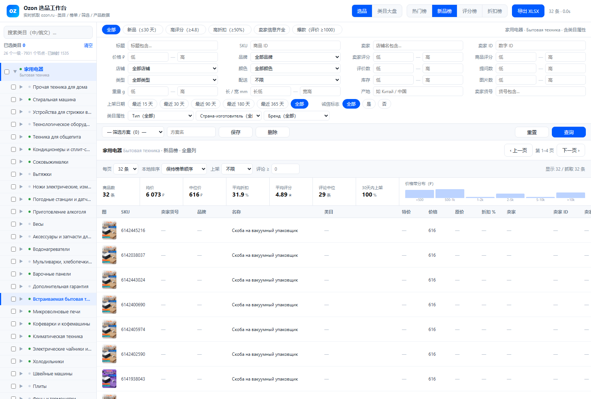

# Ozon 选品工作台

本地网页工具，实时抓取 `ozon.ru`：全量类目树（中俄双语）、类目属性筛选、全量商品详情、
类目大盘对比，一键导出 XLSX。所有数据实时在线查询，不落库。



## 功能

| 模块 | 说明 |
|---|---|
| **全量类目树** | Seller API 三层树：26 一级 / 542 二级 / 7363 类型 = 7931 节点，**官方 ZH_HANS 中文**，逐层展开、可多选 |
| **两栏筛选** | 左栏 Ozon 原生条件（品牌/店铺/颜色/类型/配送/价格）、右栏详情列条件（卖家/评分/产地/尺寸…），顶部 6 个分段预设，筛选方案可保存 |
| **全量列表** | 默认 29 列短值/数值列（SKU/卖家货号/品牌/三档价格/评分/评价/提问/库存/产地/长宽高…），点表头排序 |
| **商品详情** | 抽屉展示 36 列全量：卖家工商信息、图片库、描述全文、完整属性 |
| **类目大盘** | 多类目横向对比，含卖家集中度 CR1/CR5、卖家评分分布、机会分热力图 |
| **导出** | XLSX，长文本列全量输出，缩略图内嵌 |

## 快速开始

```powershell
# 1) 填 Seller API 凭证（可选，只影响类目树中文与类目属性）
copy config.example.json config.json     # 然后填入 client_id / api_key

# 2) 一键启动（拉起指纹对齐的 Chrome + 本地服务 + 打开页面）
web\启动选品台.bat
# 或手动：
powershell -ExecutionPolicy Bypass -File web\launch_chrome.ps1
python web\server.py --port 8899
```

打开 http://127.0.0.1:8899/

## 为什么需要 Chrome

`ozon.ru` 的 `abt-challenge` 会 403 掉所有纯 HTTP 请求，所以取数走本机 Chrome 的调试端口
（CDP），在真实浏览器上下文里 `fetch`。TLS 握发现在浏览器进程里，服务端看到的就是真 Chrome 指纹。

反风控细节（UA 与 Client Hints 对齐、最小请求头实验、节奏控制与熔断、代理配置）见
[`web/README.md`](web/README.md#反风控指纹与节奏)。

## 目录

```
web/      本地服务 + 前端（server.py / static / README.md 详细文档）
tools/    抓取与标定脚本（类目树、榜单、快照、指纹自检…）
config.example.json   Seller API 凭证模板（真正的 config.json 不入库）
```

完整文档（字段口径、接口清单、上架日期推算、限流处置）见 **[web/README.md](web/README.md)**。

---

## 附录：Ozon 榜单 / 数据源 实测结论

> 实测时间：2026-11-06　目标站点：https://www.ozon.ru　样本：5 个一级类目

### 一、结论速查

| 你要的东西 | Ozon 有没有 | 入口 | 实测状态 |
|---|---|---|---|
| 新品榜 | ✅ 有 | `/category/{类目}/?sorting=new` | 已抓通，返回 SKU 全为高位新 ID |
| 热门榜（综合热度） | ✅ 有 | `?sorting=score` | 已抓通，与新品榜 0 重叠 |
| 评分榜 | ✅ 有 | `?sorting=rating` | 已抓通 |
| 折扣榜 | ✅ 有 | `?sorting=discount` | 已抓通，单页最多 36 条 |
| 关键词搜索榜 | ⚠️ 有但被 robots 禁 | `/search/?text=` | 能抓，robots 里 `/search/` 是 Disallow |
| 单品产品数据 | ✅ 有 | 榜单返回的 tile 里已含 8 个字段 | 已解析 |
| 大盘数据（GMV/类目容量/搜索量） | ⚠️ 前台没有 | 只能走卖家后台或第三方 | 见第四节 |

**一句话**：Ozon 前台没有叫「榜单」的独立页面，但类目页的排序参数就是官方榜单——`new / score / rating / discount` 四种，换参数换榜。这四种返回的商品集合实测 **完全互不重叠**，是真正不同的排序逻辑，不是同一批货换个马甲。

## 二、榜单入口清单

基础地址：
```
https://www.ozon.ru/category/{类目slug}/?sorting={排序}&page={页码}
```

| 排序值 | 榜单含义 | 观察特征 |
|---|---|---|
| `new` | 新品/上新 | SKU 集中在 6.0e9~6.2e9 高位段，即近期新建商品 |
| `score` | 综合热度（默认「Популярные」） | 价格跨度最大，含低价引流款 |
| `rating` | 好评榜 | 老 SKU 为主，评分集中在 4.8~5.0 |
| `discount` | 折扣榜 | 折扣普遍 −50%~−90% |

一级类目 slug（35 个，实测从类目页提取，可直接用）：

```
elektronika-15500                   telefony-i-smart-chasy-15501
noutbuki-planshety-i-elektronnye-knigi-8730   bytovaya-tehnika-10500
televizory-i-videotehnika-15527     audiotehnika-15543
kompyuternye-komplektuyushchie-15709 tsifrovye-tovary-32056
igry-i-soft-13300                   odezhda-obuv-i-aksessuary-7500
obuv-17777                          aksessuary-7697
krasota-i-zdorove-6500              apteka-6000
dom-i-sad-14500                     mebel-15000
stroitelstvo-i-remont-9700          bytovaya-himiya-14572
produkty-pitaniya-9200              supermarket-25000
detskie-tovary-7000                 sport-i-otdyh-11000
ohota-rybalka-turizm-33332          avtotovary-8500
avtomobili-39803                    tovary-dlya-zhivotnyh-12300
knigi-16500                         kantselyarskie-tovary-18000
hobbi-i-tvorchestvo-13500           yuvelirnye-ukrasheniya-50001
antikvariat-vintazh-iskusstvo-8000  elektronnye-sigarety-i-tovary-dlya-kureniya-35659
muzyka-i-video-13100                tovary-dlya-vzroslyh-9000
podarochnye-sertifikaty-37234
```

## 三、产品数据字段（每个商品都能拿到）

| 字段 | 示例 | 说明 |
|---|---|---|
| sku | 6065894572 | Ozon SKU |
| name | Наушники, черно-серый, черный матовый | 标题 |
| price | 5845 | 现价 ₽ |
| price_original | 1096 | 划线原价 ₽ |
| discount | −44% | 折扣 |
| stock | 490ед осталось | 库存提示（部分商品有） |
| rating | 4.8 | 评分 |
| reviews | 5 245 отзывов | 评论数 |
| url | https://www.ozon.ru/product/... | 商品链接 |

## 四、大盘数据的三个来源

前台榜单只能给到「哪些货在榜 + 它们的价格/评分/评论」，**拿不到销量、GMV、类目容量、搜索量**。这三样在：

1. **Ozon 卖家后台（免费，需卖家账号）**
   `https://seller.ozon.ru/app/analytics` —— 市场分析、类目趋势、搜索词、竞品监控。这是唯一的一手大盘。
2. **第三方付费工具**
   mpstats / moneyplace / sellerstats / ozondata —— 直接买现成榜单和销量估算。
3. **自建聚合（本仓库的做法）**
   抓多类目 × 多排序的榜单快照，按天存，用价格带 / 折扣 / 评分 / 评论中位数做近似大盘。能看趋势和结构，不能替代真实销量。

## 五、工具用法

**前置**：本机 Chrome 需以调试端口启动（脚本会复用它的会话过 Ozon antibot）。

```powershell
# 1) 起一个带调试端口的 Chrome（已过验的 profile 会复用）
& "C:\Program Files\Google\Chrome\Application\chrome.exe" `
  --headless=new --remote-debugging-port=9222 `
  --user-data-dir="$env:TEMP\ozon_cdp_prof" https://www.ozon.ru/

# 2) 抓榜单
node tools\ozon_rank.mjs --category elektronika-15500 --sort new,score --pages 10 --out data\2026-11-06

# 3) 全类目 × 四榜
node tools\ozon_rank.mjs --all --sort new,score,rating,discount --pages 10 --out data\2026-11-06

# 4) 出大盘汇总
python tools\report.py data\2026-11-06
```

参数：`--category` 逗号分隔多个 slug ｜ `--all` 35 个一级类目 ｜ `--sort` 四选多 ｜ `--pages` 每榜页数（**8 条/页**，10 页 = 80 条）｜ `--delay` 请求间隔 ms ｜ `--out` 输出目录。

输出：`{类目}__{排序}.csv`（明细）、`_summary.json`（单次统计）、`_stats.csv` + `_report.md`（大盘汇总）。

## 六、工程注意

- **antibot**：Ozon 用自家 `abt-challenge`，纯 HTTP 请求一律 403。必须先让真浏览器过一次挑战拿到 cookie，再在页面上下文里 `fetch`。`tools/cdp_fetch.mjs` 就是这个思路。
- **分页**：`&page=N` 每次只返回 8 条（一屏 row），且必须带 `layout_container=searchResultsV2`。`infiniteVirtualPaginator` 里的 `nextPage` token 是一次性的，别用。
- **robots**：`Allow: /category/*/?page=` 明确放行类目分页；`/search/` 是 Disallow，所以本工具走类目不走搜索。
- **频率**：建议 `--delay 400` 以上，单类目四榜十页约 80 秒。
