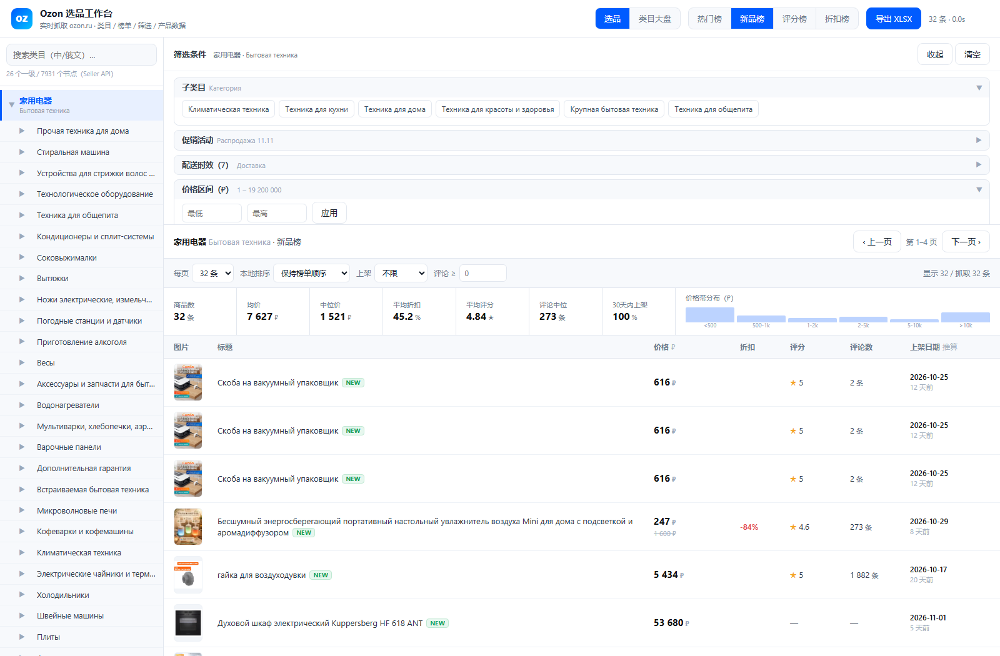
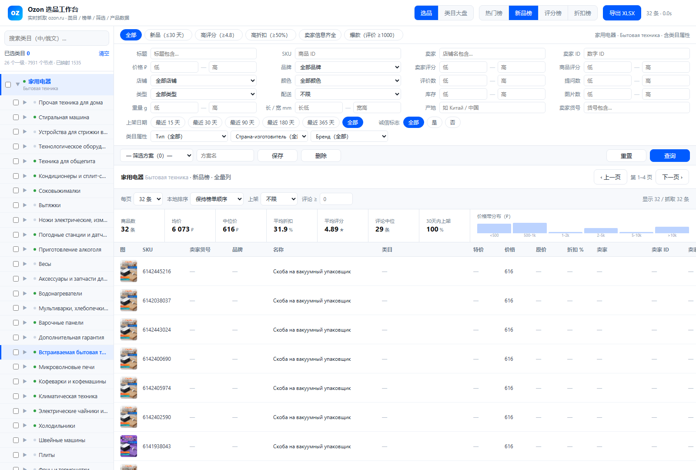
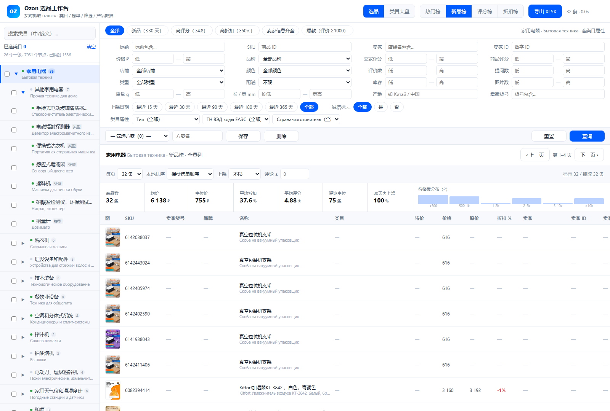
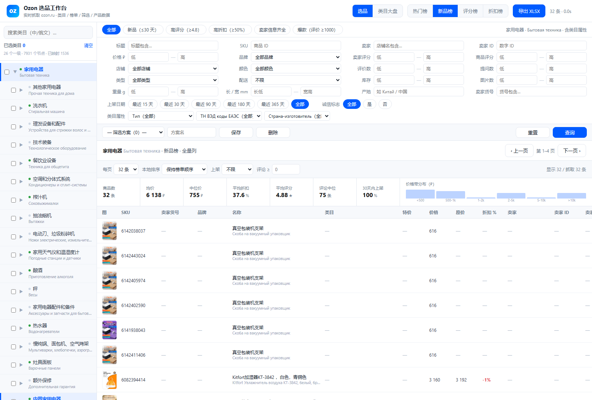
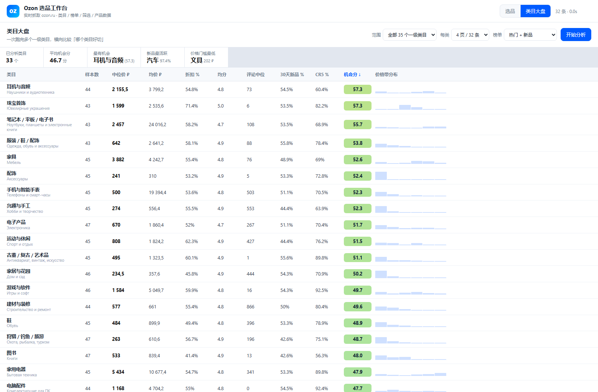

# Ozon 选品工作台

本地页面，实时抓取 ozon.ru：左栏全类目树，右侧上半部逆向还原的筛选条件，下半部产品数据表 + 大盘指标条。
浅色主题，中俄双语对照。类目树采用「复选框 + 勾选式多选」布局（参考美客多选品页的交互形态，
**只是界面形态参考，不涉及美客多数据，也没有任何对蓝鲸/美客多接口的请求**）。



**启动**

**双击** `web\启动选品台.bat`（先用 `launch_chrome.ps1` 拉起指纹对齐的 Chrome，再起本地服务并开页面）。

手动：

```powershell
# 1) 浏览器（UA 按本机真实版本生成、默认有头、可挂代理）
powershell -ExecutionPolicy Bypass -File web\launch_chrome.ps1
#    可选: -Headless / -Proxy "socks5://127.0.0.1:1080"

# 2) 起服务
python web\server.py --port 8899
# 打开 http://127.0.0.1:8899/
```

自定义端口：`set OZON_WEB_PORT=9000`。CDP 端口：`set OZON_CDP_PORT=9223`。

## 类目属性筛选

Ozon 的筛选分两层，本项目两层都接了：

### 1. 前台「全部筛选」——真正能筛的类目属性

类目页侧边栏只给 10~16 个通用条件（价格/品牌/颜色/店铺…）。**完整的类目属性**在
「Все фильтры / 全部筛选」弹窗里，入口就藏在页面 JSON 的 `showAllButton`：

```
/modal/allFilters/category/<slug>/?layout_container=searchResultsV2&sorting=<sort>
```

`/api/filters` 现在**优先取这个弹窗**，拿到什么就渲染什么（处理器用通用遍历找
`sections[].filters[]`，不依赖具体 widget 名），失败才退化到类目页侧边栏。
返回里带 `src` 字段标明来源：`allFilters` / `category` / `blocked`。
带 `src=allFilters` 时，筛选面板里就会出现该类目专属的属性条件，选中的值直接作为
URL 参数发给 ozon——这是唯一「保证 key 与 value 都对得上」的路径。

### 2. Seller API 发品属性——选品参考

`/api/attrs?cat=<slug>`：

1. 用 `category_map.json` 反查该 web 类目对应的 Seller 树节点；
2. 宽类目（如「电子产品」）本身没有 type，自动下沉到第一个带类型的子类目（面板上会标明取的哪个）；
3. 调 `POST /v1/description-category/attribute` 拿属性表；
4. 对每个 `dictionary_id != 0` 的属性再调 `/v1/description-category/attribute/values` 拉字典值；
5. 结果按 `desc_id:type_id` 缓存到 `web/attrs_cache.json`，第二次打开 0 请求。

界面上是筛选面板最下面的「类目属性（N 项 / 字典 M 项）」可折叠块，带搜索框，
可以按属性名或值搜，默认只显示有可选值的属性。

**为什么这些值不能直接当筛选参数**——两套 ID 命名空间不同，实测对照：

| | Seller 字典 id | 前台筛选 key |
|---|---|---|
| 颜色 · черный | `61574` | `100955526` |
| 品牌 · Samsung | `5060050` | `24565087` |
| 类目 · Электроника | `15621042` | `15500` |

同一条数据在两边是两套主键，名字是唯一共同的桥。所以属性面板定位是**选品参考**
（告诉你这个细分类目到底考哪些属性、属性的取值范围有多宽），
真正的筛选走第 1 条路径。

## 反风控：指纹与节奏

### 1. TLS 指纹本来就是真 Chrome（有实测）

所有 ozon 请求都走本机 Chrome 的 CDP，握手发生在浏览器进程里，
所以服务端看到的就是一套真实 Chrome 指纹。`tools/fingerprint_check.mjs` 自检结果：

```
JA3         12594014e9e6043cf1ccd1dbcac6f12c
JA4         t13d1517h2_8daaf6152771_cb7bf5808d99
PeetPrint   fc97c1cdfb1409c9a9326c1b726d1dee
HTTP/2      akamai 52d84b11737d980aef856699f885ca86
TLS         771 / 16 ciphers / h2
```

`ja3`/`ja4`/`akamai h2` 三项都是 Chrome 的标准值。**结论：TLS 层不需要伪装，也不能再伪装**
（用 curl_cffi 之类反而会退化成「像浏览器的库」，比真浏览器更容易被判定）。

### 2. 修掉了一个真实存在的指纹矛盾

原来是写死 `--user-agent=...Chrome/131...`，但本机 Chrome 是 156，
`Sec-CH-UA` 客户端提示报的是 `"Google Chrome";v="156"` —— **UA 与 Client Hints 版本对不上**，
这是典型自动化特征。现在 `web/launch_chrome.ps1` 会读本机 Chrome 版本动态生成 UA，
保证两边一致；同时默认**有头运行**（headless 的插件列表、渲染特征更容易被识别）。

### 3. 反直觉发现：伪造请求头反而被 403

想在 fetch 里补上「像 SPA」的头，实测直接触发风控：

| 请求头组合 | 结果 |
|---|---|
| 只有 `accept: application/json` | **200** |
| `accept` + `accept-language` | **200** |
| `accept` + `x-o3-app-name` | **200** |
| accept + accept-language + x-o3-app-name + `sec-fetch-*` 全套 | **403 incidentId** |

`sec-fetch-*` 是浏览器自己管理的禁止修改头，用 fetch 覆盖它本身就不正常，
WAF 一看就抓。现在只发最小集 `accept`。复现脚本：`tools/header_probe.mjs`。

### 4. 真正管用的是节奏控制（Governor）

ozon 的限流是按**出口 IP 的请求密度**算的，不是指纹。所以核心是这张网：

| 机制 | 参数 |
|---|---|
| 最小请求间隔 | 0.85s（`config.json` 可调） |
| 抖动 | ±45%，避免固定节奏被识别成脚本 |
| 并发 | 1（信号量限死） |
| 熔断 | 命中 `incidentId` 后冷却 60s，连续命中按 60→120→240…指数退避，上限 30 分钟 |
| CDP 抖动 | 只停 15s，不占用熔断配额 |
| 标签页 | **复用同一个标签页**，不反复 `/json/new`（标签抖动是明显自动化特征） |
| 脏标签页 | 一旦出现 captcha/complaint/incident，自动弃用并新建 |
| 缓存 | 同 URL 90s 内复用，翻页/切榜不重复打 |

查看状态 / 手动清冷却：

```powershell
curl http://127.0.0.1:8899/api/net/status
curl http://127.0.0.1:8899/api/net/reset     # 清冷却 + 清缓存 + 换新标签页
```

### 5. 换出口 IP 才是最后一道保险

真被按 IP 封了，上面所有手段都绕不过去，只能换出口。`config.json` 里配：

```json
"proxy": { "enabled": true, "server": "socks5://127.0.0.1:1080" }
```

`launch_chrome.ps1` 会自动带 `--proxy-server`，代理生效在浏览器进程层面，
TLS 握手仍然由 Chrome 完成，指纹保持一致。

## 筛选表单（紧凑四栏）

不再是「一大堆收起/展开的折叠栏」，也不是占半屏的大表单，而是**四栏紧凑网格**：



```
┌ 全部 · 新品≤30天 · 高评分≥4.8 · 高折扣≥50% · 卖家信息齐全 · 爆款≥1000 ───────┐
│ 标题      │ SKU       │ 卖家       │ 卖家ID      │
│ 价格 低—高 │ 品牌▾     │ 卖家评分 低—高 │ 商品评分 低—高 │
│ 店铺▾     │ 颜色▾     │ 评价数 低—高  │ 提问数 低—高  │
│ 类型▾     │ 配送▾     │ 库存 低—高   │ 图片数 低—高  │
│ 重量 低—高 │ 长/宽 低—高│ 产地       │ 卖家货号     │
├ 上架日期 15/30/90/180/365/全部 · 诚信标志 全部/是/否 · 类目属性▾▾▾ ────────┤
│ [方案▾][方案名][保存][删除]                        [重置]  [查询]         │
└──────────────────────────────────────────────────────────────────────────┘
```

整块筛选区高度约 **390px**（原来 560px），产品表一屏能多看 3~4 行。
输入框 26px 高、行距 5px，标签右对齐 62px。

- 左两栏走 **Ozon 服务端筛选**（品牌/店铺/颜色/类型/配送/价格），下拉项从 `allFilters` 实时拉；
- 右两栏走 **详情列本地筛选**（卖家、卖家评分、产地、尺寸…），需要 PDP 详情；
- 顶部六个**分段预设**一键填充条件（填充后不自动查询）；
- 类目属性是 Seller API 的字典属性下拉，按当前类目动态给 3 个。

### 筛选方案（保存 / 载入）

表单底部左侧就是方案区：

```
[— 筛选方案（3）—▾]  [方案名]  [保存]  [删除]        [重置]  [查询]
```

- **保存**：把当前整套条件（品牌/店铺/颜色/类型/配送、价格区间、标题、SKU、卖家ID、
  右栏全部区间条件、上架天数、诚信标志、顶部预设、本地排序、每页条数）打包存下来；
  同名再存 = **覆盖更新**。
- **载入**：下拉选中即把条件填回表单（**不会自动查询**，仍然要点「查询」）。
- **删除**：删掉选中的方案。
- 存在浏览器 `localStorage`（key `ozon.filterSchemes.v1`），刷新和重启服务都不丢；
  换浏览器/清缓存会丢。

方案只存**筛选条件**，不绑类目——同一套条件可以套到不同类目上对比。

## 全量列（默认）与详情筛选

**选品表默认就是全量列**，不需要勾选任何开关。每次搜索完会自动补当前页的 PDP 详情
（32 条约 1 分钟，走 0.85s 节奏），抓的过程中表格逐批刷新。

**表格里只放短值/数值列**（点表头排序、进「详情筛选」筛选）：

```
图 · SKU · 卖家货号 · 品牌 · 名称 · 类目 · 特价 · 价格 · 原价 · 折扣%
卖家 · 卖家ID · 卖家评分 · 卖家评价/订单 · 店龄 · 公司名称 · 工商注册号 · 诚信标志
评分 · 评价数 · 提问数 · 数量 · 图片数 · 产地 · 长 · 宽 · 高 · 重量 · 上架日期
```

**长文本留在右侧抽屉**：点任意行打开，含 全部大图、图片库、URL、卖家主页、
卖家地址、描述全文、富文本、完整属性表。

**详情筛选**（面板顶部，和选品表共用同一套条件；类目大盘也用它）：

- 文本包含：品牌 / 卖家 / 产地 / 卖家货号 / 工商注册号
- 枚举：诚信标志（是 / 否）
- 下限：卖家评分 ≥、商品评分 ≥、评价数 ≥、提问数 ≥、图片数 ≥
- 区间：库存、重量(g)、长度(mm)、宽度(mm)

没抓详情的行，在有详情条件时会被排除（避免空值混进来误导判断）。

导出的 XLSX 仍是 **36 列全量**（长文本列在 Excel 里才放得下）。

## 类目大盘：卖家维度

大盘的「详情」下拉控制每个类目补多少个 PDP 样本（0 / 8 / 16）。
选 8 或 16 时才能算卖家维度：

| 列 | 含义 |
|---|---|
| 详情数 | 该类目实际补到详情的商品数 |
| 评论CR5 % | 评论数前 5 名占样本总评论的比例（口碑垄断度） |
| **卖家数** | 样本里出现过的不重复卖家数 |
| **卖家CR1 %** | 最大卖家占样本商品数的比例（单品独大程度） |
| **卖家CR5 %** | 前 5 个卖家占样本商品数的比例（**卖家集中度**） |
| **卖家均分** | 样本卖家的平均店铺评分 |
| **低分卖家 %** | 卖家评分 < 4.5 的占比（**卖家质量分布**） |

同时，选品页顶部那套「详情筛选」条件会**原样带进大盘**——大盘只统计符合条件的那批商品。
所以「只看中国产地 + 卖家评分 ≥4.8」再跑大盘，得到的就是这个条件下的类目对比。

实测（10 个类目 × 2 页 × 详情 8）：

```
家用电器      n=16 卖家=3  CR1=75.0% CR5=100% 卖家均分4.8 低分0%
数码商品      n=16 卖家=3  CR1=62.5% CR5=100% 卖家均分4.9 低分0%
笔记本/平板   n=16 卖家=6  CR1=37.5% CR5=87.5% 卖家均分4.8 低分0%
服装/鞋/配饰  n=16 卖家=5  CR1=50.0% CR5=100% 卖家均分4.7 低分25%
```

> 样本量提醒：详情数只有 8 时 CR 值的分母是 8，抖动大。要看趋势建议详情拉到 16、每类 3 页以上。

## 全量商品详情（36 列）

工具栏「抓全量详情（前 30）」：对当前视图前 30 个 SKU 逐个抓 PDP，产出 36 列全量记录，
导出 XLSX 时自动切到全量列。

```
GET /api/product/full?skus=1790838487,1790838488
```

每个商品请求 **2 个页面**：

| 请求 | 拿到什么 |
|---|---|
| `/product/{sku}/` | 价格 / 卖家 / 评分 / 评价 / 提问 / 库存 / 图片 / 面包屑 |
| `/product/{sku}/?layout_container=pdpPage2column&layout_page_index=2` | **描述 + 完整属性（含产地/长宽高/重量）** |

### 字段来源（逆向自 marketninja 插件的列定义 + 实测校正）

| 列 | 来源路径 |
|---|---|
| SKU | `webGallery.sku` |
| 卖家货号 | `webCurrentSeller.chat.placeholderValue` 正则 → 兜底 seo meta |
| 品牌 | 面包屑末段（`/category/{类}/{品牌}-{id}/`）→ 兜底属性「Бренд」 |
| 名称 | `webProductHeading.title` |
| 类目 | `breadCrumbs.breadcrumbs[].text` 用 ` / ` 连接（去掉品牌段） |
| 特价 | `webPrice.cardPrice`（Ozon 银行卡价） |
| 价格 / 原价 / 折扣 | `webPrice.price` / `webPrice.originalPrice` / 计算 |
| 卖家 / 卖家ID / 卖家评分 | `webCurrentSeller.sellerCell` / `header.badge...params.sellerId` / `rating.title.text` |
| 卖家评价、订单数 | `webCurrentSeller.trustFactors[]` 里 title=Заказы 的 badge |
| 公司名称 / 工商注册号 / 地址 / 诚信标志 | `trustFactors[]` 里 title=О магазине 的 `tooltip.subtitle`，正则取 13/15 位 ОГРН |
| 卖家主页 | `sellerCell.common.action.link` |
| 评分 / 评价数 / 提问数 | `webReviewProductScore.totalScore` / `.reviewsCount` / `webQuestionCount.text` |
| 数量（库存） | `bigPromoPDP.stockNumber.text` |
| 图片数 / 缩略图 / 图片库 | `webGallery.images[]` + `coverImage` |
| 描述 / 富文本 | `webDescription.richAnnotation`（HTML）/ `richAnnotationJson` |
| 产地 / 长宽高 / 重量 | `webCharacteristics.characteristics[0].short[]` 按属性名归一化：Страна→country、Длина→length、Ширина→width、Высота→height、Вес→weight |
| 完整属性 | 同上，全量拼成 `名称: 值; …` |

实测（SKU 1790838487）：

```
brand=VIRA  country=Китай  L=220 W=75  attrs=12
seller=Viratools(2188) rating 4.9 · 9.7M orders · ООО "ДИ АЙ ВАЙ ТУЛЗ" · ОГРН 1147847008858
特价716 / 价格795 / 原价884 / 折扣19%   评分4.8 · 11105评价 · 46提问 · 库存3239 · 8图
```

> 缺口说明：`店龄`、`重量`、`高度` 这些字段**不是每个商品都有**——Ozon 只在卖家填了才显示，
> 抓不到就是空，不是解析失败。插件里标 `[PREMIUM]` 的列（卖家评分/评价/店龄等）属于其付费功能，
> 我们是直接从页面 JSON 取，能取到就填。

## 两套数据源

## 类目树：三层完整结构

数据是 **Seller API 原样返回的三层树**，不是只到二级：

| 层级 | 节点数 | 说明 | 示例 |
|---|---|---|---|
| L1 一级类目 | **26** | `description_category_id` | 家用电器 / Бытовая техника |
| L2 二级类目 | **542** | `description_category_id` | 洗衣机 / Стиральная машина |
| L3 商品类型 | **7363** | `type_id` | 滚筒式干衣机 / Сушильная машина |

合计 **7931** 个节点，**7909 个带官方中文**（差的那 1 个是品牌名 BCAA）。



交互上做了三件事让第三层不再“看不见”：

1. **节点后面显示子节点数**（`家用电器 35`、`洗衣机 6`）——一眼知道能不能展开；
2. **点类目名会自动展开**，不用再去点那个小三角；
3. 小三角加大到 16px、hover 高亮、展开后旋转 90°。

三级（类型）节点点下去会拿类型名去前台解析，实测都能落到真实类目页：

```
Стеклоочиститель электрический ручной → /category/stekloochistiteli-10678/
Стиральная машина                     → /category/stiralnye-mashiny-10507/
Электробритва                         → /category/elektrobritvy-10760/
```

### L3 全量预解析

三级（type）节点共 7363 个，需要把「类型名」解析成前台 `/category/slug-id/` 才能点开。
跑批量解析：

```powershell
node tools\bulk_resolve.mjs --conc 4        # 走本地服务的 /api/resolve，可随时中断续跑
curl http://127.0.0.1:8899/api/map/stats    # 看进度
```

**解析策略（两级）**：

1. 先看 Ozon 搜索有没有**自动预测**到类目页（`pageInfo.url` 直接变成 `/category/.../`）；
2. 没预测到就退回**候选匹配**：搜索结果里的 `categoryFilter` 会给出若干候选类目，
   用「最长公共子串」给候选名和类型名打分，≥5~6 个字符才认（L0 顶级类目要求更高，避免乱配）。

**速度上限约 0.8~1 次/秒**，受 ozon 按 IP 计速限制，7000 多个名字约需 2 小时。
脚本可随时 Ctrl+C，重跑自动跳过已映射的。

**会不会有解析不到的**：会。Ozon 卖家侧有些分组（比如「Прочая техника для дома」
「Фермерское хозяйство」）在前台没有一一对应的类目页，这些节点会保持灰点；
点它们时会退到候选匹配或提示「没有对应类目」。这是数据本身的差异，不是解析失败。

## 中俄双语



**类目和属性用 Ozon 官方中文，不是机器翻译。**

`/v1/description-category/tree` 和 `/v1/description-category/attribute` 都支持 `language` 参数，
官方直接提供简中 `ZH_HANS`。所以拉两遍、按 id 对齐即可：

```python
ru = fetch("DEFAULT")     # 俄文
zh = fetch("ZH_HANS")     # 官方简中
tree = merge_by_id(ru, zh)
```

实测：**7931 个节点里 7909 个有官方中文**（只差 1 个「BCAA」，是品牌名）。
属性同理：39 个发品属性全部有官方中文名（「使用寿命，年数」「最大功率 W」），
字典值也是中文（白色 / 透明 / 米色 / 黑色…）。

| 位置 | 中文来源 | 显示方式 |
|---|---|---|
| 左栏类目树（7931 节点） | **官方 ZH_HANS** | 中文主 + 俄文小字 |
| 类目属性名 | **官方 ZH_HANS** | 中文主 + 俄文小字 |
| 属性字典值（颜色等） | **官方 ZH_HANS** | 中文 |
| 筛选组标题 / 颜色 / 配送 | 人工对照表 | 中文主 + 俄文小字 |
| 商品标题 | 词典 + 组合式翻译（`web/zh.py`） | 中文主 + 俄文小字 |
| 产地 | 官方属性值 + 国家词典 | 中国 / Китай |
| 品牌 / 卖家名 | 保持原文（专有名词） | 原文 |
| 描述 | 不翻译（按要求） | 俄文原文 |

商品标题是唯一需要机器翻译的（Ozon 不提供标题翻译）。做法：
`web/zh.py` 里三层——人工词表（品类/颜色/材质/规格约 400 词）→ 整句短语 → MyMemory 在线兜底，
查过的写进 `translate_cache.json` 永不再查，每日在线额度 600 条封顶。
命中率不够（<60%）时**宁可不译**，只显示俄文，不编造。


| 数据源 | 地址 | 用途 | 认证 |
|---|---|---|---|
| **ozon.ru 前台**（composer-api） | `www.ozon.ru/api/composer-api.bx/...` | 选品、榜单、筛选、商品数据、大盘 | 无（靠浏览器过 antibot） |
| **Ozon Seller API** | `api-seller.ozon.ru` | 权威**全量类目树** | `Client-Id` + `Api-Key` |

### Seller API 类目树

```bash
POST https://api-seller.ozon.ru/v1/description-category/tree
Client-Id: <client_id>
Api-Key:  <api_key>
Body: {"language":"DEFAULT"}
```

返回 **26 个一级 / 542 个二级 / 7363 个叶子类型（type_id）＝ 7931 个节点**，
这是卖家侧权威分类（发品用的那套），比前台 `/category/` 口径完整得多。

凭证放 `config.json`（或用环境变量 `OZON_CLIENT_ID` / `OZON_API_KEY` 覆盖），
重新拉取并生成树文件：

```powershell
python tools\build_tree.py       # -> web\categories_tree.json
```

### 类目名 → 前台 URL 的映射

Seller 的 `description_category_id`（如 15621042）和前台 `/category/elektronika-15500/`
里的 15500 **是两套 ID**，不能直接互换。所以用「名字解析」搭桥：

1. `web/category_map.json` 里的缓存优先；
2. 手工表 `MANUAL_MAP`（6 个搜索解析不到的聚合类目）；
3. 都没有时：拿类目名去 ozon.ru 搜一次，Ozon 会**自动预测到类目页**
   （`/search/?text=Пылесосы` → `/category/pylesosy-i-aksessuary-10648/`），
   从中取 slug 并写回缓存。

**批量预解析**（并发 + 顺带收获）：

```powershell
node tools\bulk_resolve.mjs                          # 默认 并发2 / 1.2s 间隔（安全档）
node tools\bulk_resolve.mjs --limit 200              # 先跑 200 个试试
```

每解析一个名字，顺便把它返回的 `categoryFilter` 里的兄弟/子类目也一起收下——
一次请求能换回 5~6 条映射。脚本可断点续跑（跳过已映射），中断后重跑即可。

当前进度：`L1 26/26 · L2 229/542 · L3 383/7363`（共 1531 条映射）。
剩余部分建议挂夜里跑，别白天刷。

### 被限流 / 弹验证码了怎么办

ozon 对 composer-api 有按 IP 的速率限制。超限的表现：

```json
403 {"incidentId": "fab_cp_2026...", "captchaURL": "https://www.ozon.ru/captcha.html?captcha=..."}
```

**这时整个站点的接口一起被挡**（选品页、类目页、大盘全挂），左栏类目树不受影响因为它是本地 JSON。

恢复步骤：

1. **停掉所有抓取脚本**，等 30–60 分钟；
2. 用**普通浏览器**打开 `https://www.ozon.ru/`，如果弹验证码就手动过掉（这一步必须真人做）；
3. 过掉后重启 CDP Chrome：
   ```powershell
   Get-CimInstance Win32_Process -Filter "Name='chrome.exe'" |
     Where-Object { $_.CommandLine -like '*remote-debugging-port=9222*' } |
     ForEach-Object { Stop-Process -Id $_.ProcessId -Force }
   # 然后重新跑 启动选品台.bat
   ```
4. 用安全档重跑解析：`node tools\bulk_resolve.mjs`（并发 2 / 1.2 秒）。

实测安全阈值：**并发 ≤ 2、每秒 ≤ 1 次**。我一开始用并发 12 跑，刷到约 460 个直连命中就被封了。

左栏节点前的圆点表示映射状态：**绿点 = 已映射**（点击秒开），灰点 = 尚未映射（点击时现场解析，约 1 秒）。

> ⚠ **限流红线**：ozon 对 composer-api 有按 IP 的速率限制，超了会返回
> `403 {"incidentId": "fab_..."}`，此时**所有接口一起被挡**（包括选品页和类目页），
> 冷却通常十几分钟到一小时，严重时要求过验证码。
> 实测安全区间：**并发 ≤ 2、每秒 ≤ 1 次请求**。`bulk_resolve.mjs` 默认已是安全档，
> 整批零命中会自动退避，连续 12 批零命中就退出并保存进度，重跑即续。


```
┌────────── 顶栏：榜单切换（热门/新品/评分/折扣） + 导出 XLSX ────────┐
├──────────┬──────────────────────────────────────────────────────────┤
│ 左栏     │ 筛选条件：子类目 / 价格 / 品牌 / 颜色 / 店铺 / 类型 …      │
│ 全 35 个 ├──────────────────────────────────────────────────────────┤
│ 一级类目 │ 工具栏：每页条数 · 本地排序 · 上架天数 · 评论数下限        │
│ +子类目  ├──────────────────────────────────────────────────────────┤
│          │ 大盘条：商品数 均价 中位价 折扣 评分 评论中位 价格带分布   │
│          ├──────────────────────────────────────────────────────────┤
│          │ 产品表：图片 | 标题 | 价格 | 折扣 | 评分 | 评论数 | 上架日期 │
└──────────┴──────────────────────────────────────────────────────────┘
```

- **中文对照**：类目、筛选组、颜色/配送取值全部中俄双语并排显示——中文为主、俄文小字为辅，
  避免中文翻译失真时对不上原站。品牌名保留俄文原文（品牌不该翻）。
- **左栏**：**Seller API 全量类目树**（26 一级 → 542 二级 → 7363 类型，共 7931 节点），
  中俄双语，逐层展开（数据全在本地 `categories_tree.json`，展开不请求网络）。
  点节点名 → 解析成前台 `/category/` 页面并加载商品。

- **多选类目**：每个节点前有复选框，勾选父节点会连带勾选整棵子树（可跨层、可跨一级类目）。
  顶部实时显示「已选类目 N」，点「清空」取消。勾选 ≥1 个后，选品结果变成**这些类目的合并结果**：

  - 服务端 `/api/search?cats=a,b,c` 逐个类目拉取后**按 SKU 去重合并**，最多 10 个类目；
  - 每行标题后面会带一个浅蓝标签标明它来自哪个类目；
  - 面包屑显示「已选 N 个类目」；
  - 没勾选时退回单类目浏览（点哪个看哪个）。
- **筛选**：从类目页 `filtersDesktop` 里逆向出来的**全部**筛选组，直接映射成 URL 参数发给 ozon：

  | 筛选 | 参数 | 取值示例 |
  |---|---|---|
  | 价格区间 | `currency_price` | `1.000;250.000` |
  | 品牌 | `brand` | `32686750`（多个逗号分隔） |
  | 颜色 | `color` | `100955526` |
  | 店铺 | `seller` | `1865500`（`0` = OZON 自营） |
  | 配送 | `delivery` | `1` 今日 / `2` 明日 / `4` 三天内 … |
  | 类型 / 型号 / 产地 | `type` / `exactmodels` / `country` | 同上 |
  | 布尔开关 | `isdiscount` / `is_installment` / `brandcertified` … | `true` |

- **榜单**（顶栏四个按钮，对应 `sorting` 参数）：

  | 按钮 | `sorting` | 说明 |
  |---|---|---|
  | 热门榜 | `score` | ozon 默认「Популярные」综合热度 |
  | 新品榜 | `new` | 按上架时间倒序，SKU 全在高位新号段 |
  | 评分榜 | `rating` | 好评优先，基本全 5.0 |
  | 折扣榜 | `discount` | 折扣力度，单页 36 条（其他 8 条/页） |

- **产品字段**（全部来自 tile 结构，无需进详情页）：

  `sku` `标题` `现价` `划线原价` `折扣%` `库存提示` `评分` `评论数` `首图` `全部图` `商品链接` `上架日期`

- **每页条数**：ozon 接口一次只回 8 条（折扣榜 36 条），本服务自动连拉 N 张 ozon 页合并去重，
  可选 8 / 32 / 64 / 96 条一屏。
- **本地排序**：上架日期升降、价格升降、折扣力度、评分、评论数——全部在前端对已抓数据排序，**不额外打 ozon**。
- **本地过滤**：`上架 ≤ 7/30/90/180 天`、`评论数 ≥ N`，同样零额外请求。
- **大盘条**：对当前视图实时算 商品数 / 均价 / 中位价 / 平均折扣 / 平均评分 / 评论中位 / 30 天内上架占比 /
  价格带分布直方图。
- **点击行**：抽屉展示全部大图、商品属性（`webShortCharacteristics`）。

## 上架日期怎么来的

Ozon **不公开**上架日期（商品页 JSON 里没有任何 date/created/published 字段，实测确认）。
所以用 SKU 反推：

1. SKU 全局自增，与创建时间强单调 → 可建 `sku → 日期` 曲线；
2. 锚点取「**首评时间**」：商品页评价列表按时间倒序，对评价数 ≤ 30 的商品一页即全量，
   其 `min(publishedAt)` ≈ 上架时间 + 少量滞后，噪音最小；
3. 按 SKU 分桶取最小值 → 再叠一个「`new` 榜最新 SKU ≈ 今天」的锚点 → 单调化。

标定结果（`web/sku_date_model.json`）：

```
4.36e8 → 2024-12-13    3.58e9 → 2026-03-05    6.25e9 → 2026-11-06
1.64e9 → 2025-02-19    4.49e9 → 2026-06-14
2.74e9 → 2025-11-28    5.31e9 → 2026-08-02
```

误差：近期（今年内）约 ±1~2 周，越老越粗。界面统一标注「推算」。
重新标定：`python tools\calibrate_sku_date.py`。

## 类目大盘页

顶栏 `[选品] [类目大盘]` 切换。一次跑完多个一级类目，横向比较「哪个类目好切」。



跑法：选范围（全部 35 / 前 10 / 前 20）× 每类页数 × 榜单组合 → 后台任务 + 进度条，
不阻塞页面。结果落盘到 `data/market_last.json`，下次打开直接读上次结果，不用重跑。

**指标口径**

| 列 | 含义 |
|---|---|
| 样本数 | 该次分析抓到的去重商品数（页数越多越准，样本 <15 标「样本少」） |
| 中位价 / 均价 | 样本身价的中位数 / 平均数，中位数抗极端值 |
| 折扣 % | 样本平均折扣力度 |
| 均分 / 评论中位 | 口碑与竞争基线 |
| **30天新品 %** | 样本里上架 ≤30 天的占比——类目的**新入场活跃度** |
| **CR5 %** | 评论数前 5 名占样本总评论数的比例——**集中度**，越高越被头部锁死 |
| **机会分** | 启发式：`40×新品活跃(归一化) + 30×(1−集中度归一化) + 30×折扣空间(归一化)` |
| 价格带分布 | 6 段直方图（<500 / 500-1k / 1-2k / 2-5k / 5-10k / >10k ₽） |

表头可点排序，点整行跳到选品页并定位到该类目。

> 口径提醒：`CR5` 用的是**累计评论数份额**做代理，不是真实销量份额（ozon 不公开销量）。
> 样本只覆盖榜单前列商品，所以「机会分」是筛选方向用的启发式，不是绝对结论。
> 榜单选「热门 + 新品」时代表性最好；只选热门榜会低估新品活跃度。

## 每日快照与黑马识别

评论增量是 ozon 上最接近真实销量的可抓指标（榜单只给累计评论数，无销量字段）。
每天跑一次快照，两次对比就能算出增速：

```powershell
# 抓今天（默认 5 类目 × 4 榜 × 3 页 ≈ 2 分钟）
python tools\snapshot.py

# 全 35 类目
python tools\snapshot.py --cats all --pages 5

# 只出报告（不抓数）
python tools\snapshot.py --report
```

产出：
- `data/snapshots/YYYY-MM-DD.jsonl` —— 当天全量快照（每 SKU 一行，含榜单、页码、抓取时间）
- `data/snapshots/_darkhorses_YYYY-MM-DD.csv` —— 黑马候选：上架 ≤ 60 天 且 评论增量最高的商品

首次运行只有基线，第二天起才出黑马榜。建议挂一个 Windows 计划任务每天跑一次。

## 接口

| 路由 | 说明 |
|---|---|
| `GET /api/tree` | Seller API 全量类目树（带已解析的 `slug`） |
| `GET /api/resolve?name=` | 类目名 → 前台 slug（缓存 + 搜索预测） |
| `GET /api/categories` | 35 个一级类目兜底映射 + 4 个榜单 |
| `GET /api/filters?cat=&sort=` | 筛选 schema（优先「全部筛选」弹窗，含类目属性；带 `src` 标明来源） |
| `GET /api/attrs?cat=` | Seller API 类目发品属性 + 字典值（磁盘缓存） |
| `GET /api/search?cat=&cats=&sort=&page=&pages=4&filters={}` | 产品列表；`cats` 逗号分隔可多类目合并去重 |
| `GET /api/product?sku=` | 单品详情：全部大图 + 属性 + 上架日期 |
| `GET /api/market/start?cats=&pages=&sorts=` | 启动类目大盘后台任务，返回 jobId |
| `GET /api/market/status?id=` | 任务进度 + 增量结果 |
| `GET /api/market/last` | 上次大盘结果（`data/market_last.json`） |
| `POST /api/export` | 传当前行数组，生成带内嵌缩略图的 XLSX 到 `export/` |

## 工程注意

- **antibot**：纯 `requests` 一律 403（`abt-challenge`）。本服务通过 CDP 在真实浏览器上下文里 `fetch`，
  首次连接会等挑战页通过再放行。
- **分页**：`&page=N` 必须与 `layout_container=searchResultsV2` 同时出现，否则拿不到商品；
  每页 8 条（折扣榜 36 条）；`infiniteVirtualPaginator.nextPage` 的 token 一次性，别用。
- **缓存**：同一 `path+query` 90 秒内复用，翻页/切榜单不会重复打 ozon。
- **robots**：`Allow: /category/*/?page=` 放行类目分页；`/search/` 是 Disallow，所以只走类目不走关键词搜索。
- **图片**：走的 `ir-20.ozonstatic.cn` CDN，页面上用 `referrerpolicy="no-referrer"` 直连。

## 文件

```
web/
├── server.py            服务端（静态 + 12 个 API + 节奏控制 + XLSX 导出）
├── launch_chrome.ps1    指纹对齐的 Chrome 启动器（UA/版本一致、有头、代理）
├── categories_tree.json Seller API 全量类目树（7931 节点）
├── category_map.json    类目名 → 前台 slug 缓存
├── attrs_cache.json     Seller API 类目属性缓存
├── sku_date_model.json  SKU→上架日期 标定曲线
├── static/
│   ├── index.html
│   ├── app.js           类目树 / 筛选 / 本地排序过滤 / 大盘条 / 类目大盘 / 详情
│   └── style.css        浅色主题
├── 启动选品台.bat
└── README.md

tools/
├── build_tree.py         Seller API 拉全量类目树
├── fingerprint_check.mjs TLS/JA3/JA4 + 请求头 自检
├── header_probe.mjs      请求头组合对照实验（定位哪一项触发风控）
├── ozon_rank.mjs         命令行抓榜（CSV）
├── cdp_fetch.mjs         CDP 取数底座（绕过 antibot）
├── parse_tiles.py        榜单解析
├── report.py             跨类目大盘汇总
├── calibrate_sku_date.py SKU→上架日期 标定
└── snapshot.py           每日快照 + 黑马识别

config.json               Seller API 凭证 + Apifox MCP 配置
```

> Apifox MCP（`apifox-mcp-server --site-id=3531025`）只用来查 Ozon Seller API 文档，
> 取数直接走 `api-seller.ozon.ru`，不经过 MCP。配置留档在 `config.json` 的 `apifox_mcp` 字段。


